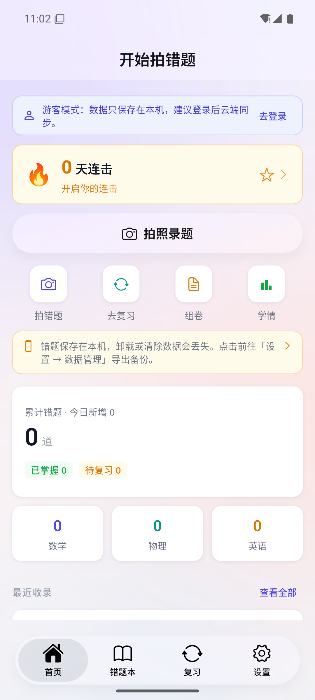
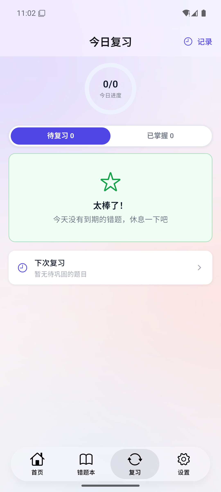
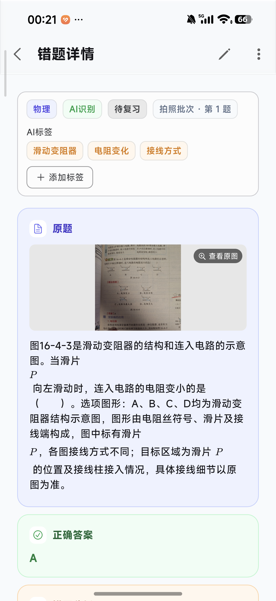
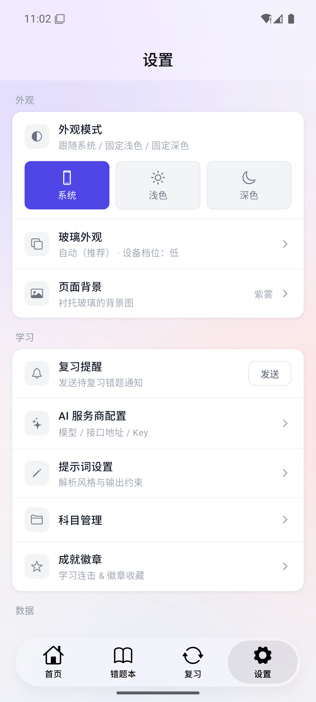
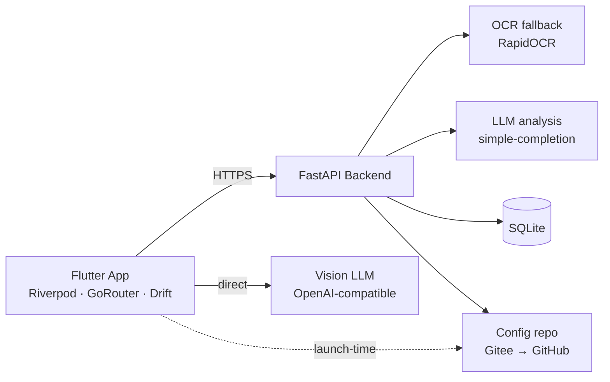
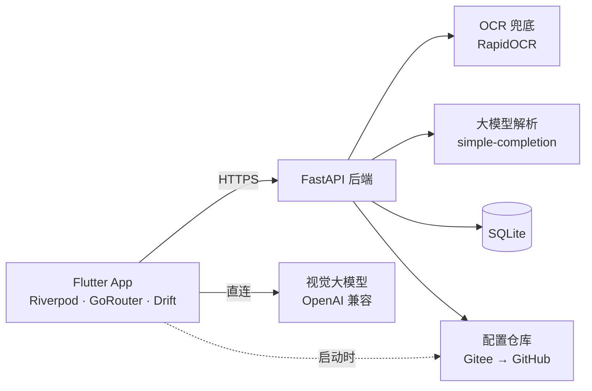
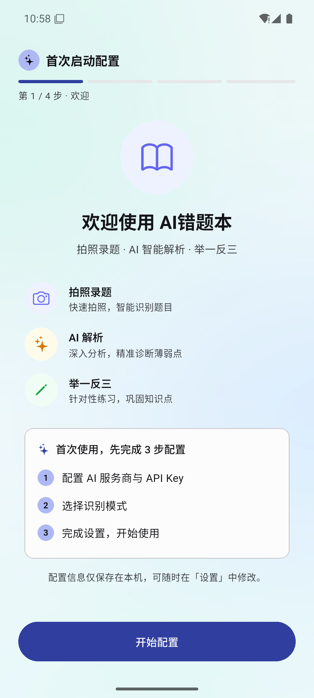

<div align="center">

# AI Wrong Notebook Pro · AI 错题本 Pro

**Snap a wrong answer → structured by AI → reviewed on schedule → practice variants.**

**拍照错题 → AI 结构化 → 自动入库 → 同类题匹配 → 艾宾浩斯复习 → 变式组卷**

[](https://flutter.dev)
[](https://fastapi.tiangolo.com)
[]()
[](LICENSE)
[](https://github.com/Xyihang/AI-wrong-notebook/stargazers)

[English](#english) · [中文](#中文) · [Screenshots](#screenshots) · [Quick start](#quick-start) · [License](#license)

</div>

---

<p align="center">
  
  
  
  
</p>

<p align="center"><sub>Screenshots: home · review · question detail · settings (light theme)</sub></p>

---

## English

### Why
Wrong answers end up scattered across papers, photos and chats. Reviewing them means retyping. This app turns **one photo** into a structured question — stem, answer, step-by-step solution, mistake reason, knowledge points — then schedules reviews with the Ebbinghaus curve and generates practice variants.

### Features

| | Capability | Details |
|---|---|---|
| 📷 | **Capture** | camera / gallery → free crop → OCR → AI analysis |
| 🧠 | **Structured analysis** | stem, answer, steps, mistake reason, knowledge points, AI tags |
| 🔍 | **Similar-question matching** | matches your past questions on the same knowledge point |
| 🔁 | **Review loop** | Ebbinghaus scheduling · forgot / fuzzy / mastered feedback · history |
| 📝 | **AI paper generator** | scope-based mini test paper, PDF export |
| 📊 | **Learning dashboard** | totals, mastery rate, subject split, streak & badges |
| 💾 | **Local-first** | offline SQLite · import / export / clear · JSON backup |
| 🎨 | **Liquid-glass UI** | capability-tiered (high / mid / low / off) · scroll-reactive blurred bars · light & dark · 6 page backgrounds |
| 🔌 | **Dynamic backend** | API base URL resolved from a config repo at launch — switch servers without rebuilding |
| 👤 | **Guest mode** | bring your own API key, no account, data stays on device |

### Architecture



### Quick start

```bash
# 1) backend
cd backend
pip install -r requirements-slim.txt
cp .env.example .env          # set LLM_API_KEY / LLM_BASE_URL
python -m uvicorn app.main:app --host 0.0.0.0 --port 8000

# 2) app
cd frontend
flutter pub get
flutter run                    # or: flutter build apk --release
```

The backend base URL is resolved at launch from `Xyihang/ai-wrong-backend-config`
(Gitee API → GitHub API → Gitee raw → GitHub raw → bundled default).

### Tech stack
Flutter 3.41 (Riverpod · GoRouter · Drift · Dio) · FastAPI · SQLAlchemy · OpenAI-compatible vision LLM · RapidOCR fallback · custom design-token system (dual theme) · liquid-glass rendering with per-tier quality.

### Repository layout
```
frontend/   Flutter app (lib/src/features/* feature-first)
backend/    FastAPI service (ocr / retrieval / llm / business layers)
docs/       specs, plans, architecture, deployment, iOS packaging, design specs
design/     HTML UI prototypes
```

### Docs
- Specs & API contract — `docs/spec.md`
- Liquid-glass design spec — `docs/SPEC-LIQUID-GLASS.md`
- UI beautify spec (design tokens) — `docs/SPEC-UI-BEAUTIFY.md`
- Deployment — `docs/DEPLOY.md` · iOS packaging — `docs/IOS-PACKAGING.md`

### Roadmap
- [ ] Web demo (WASM) for instant try-out
- [ ] English localization
- [ ] Multi-device sync conflict resolution
- [ ] Export to Anki

---

## 中文

### 它解决什么问题
刷题时错题散落在卷子、照片、聊天记录里，复习时找不到、也不想重抄。这个 App 把「拍一张照片」变成结构化错题（题干 / 答案 / 分步解析 / 错因 / 知识点），之后自动用艾宾浩斯曲线安排复习、并生成同类变式题。

### 功能特性

| | 能力 | 说明 |
|---|---|---|
| 📷 | **拍照录题** | 相机/相册 → 自由裁剪 → OCR → AI 解析 |
| 🧠 | **结构化解析** | 题干、标准答案、分步解析、错因、知识点、AI 标签 |
| 🔍 | **同类题匹配** | 自动检索历史同知识点错题，一键回看对比 |
| 🔁 | **复习闭环** | 艾宾浩斯到期提醒 · 三键反馈（仍不会/模糊/已掌握）· 复习记录 |
| 📝 | **AI 变式组卷** | 按范围生成小卷，支持导出 PDF |
| 📊 | **学情看板** | 累计/今日新增/掌握率、科目分布、学习连击与成就徽章 |
| 💾 | **数据自主** | 本地 SQLite 离线可用 · 导入/导出/清空 · JSON 备份 |
| 🎨 | **液态玻璃 UI** | 按设备性能分档（高/中/低/关闭）· 顶栏随滚动渐变模糊 · 浅色/深色 · 6 套页面背景 |
| 🔌 | **动态后端** | 启动时从配置仓库读取后端地址，换服务器无需重新打包 |
| 👤 | **游客模式** | 不登录也能用（自带 AI Key），数据仅存本机 |

### 架构



### 快速开始

```bash
# 1) 后端
cd backend
pip install -r requirements-slim.txt
cp .env.example .env          # 填 LLM_API_KEY / LLM_BASE_URL
python -m uvicorn app.main:app --host 0.0.0.0 --port 8000

# 2) App
cd frontend
flutter pub get
flutter run                    # 或 flutter build apk --release
```

后端地址由 `Xyihang/ai-wrong-backend-config` 下发（Gitee API → GitHub API → Gitee raw → GitHub raw → 打包默认值）。

### 技术栈
Flutter 3.41（Riverpod · GoRouter · Drift · Dio）· FastAPI · SQLAlchemy · OpenAI 兼容视觉大模型 · RapidOCR 兜底 · 自建设计 Token 体系（双主题）· 液态玻璃分档渲染。

### 目录结构
```
frontend/   Flutter 前端（lib/src/features/* 按功能分层）
backend/    FastAPI 后端（OCR / 检索 / 大模型 / 业务 四层解耦）
docs/       规格、计划、架构、部署、iOS 打包、设计规格
design/     UI 设计稿（HTML 样机）
```

### 文档
- 功能规格与接口契约 — `docs/spec.md`
- 液态玻璃设计规格 — `docs/SPEC-LIQUID-GLASS.md`
- UI 美化规格（设计 Token）— `docs/SPEC-UI-BEAUTIFY.md`
- 部署 — `docs/DEPLOY.md` · iOS 打包 — `docs/IOS-PACKAGING.md`

### 路线图
- [ ] Web 体验版（WASM），免安装试用
- [ ] 英文界面本地化
- [ ] 多端同步冲突处理
- [ ] 导出到 Anki

---

## Screenshots

| Home | Review | Question detail | Settings |
|---|---|---|---|
|  |  |  |  |

<details>
<summary>Onboarding</summary>



</details>

---

## License

**PolyForm Noncommercial License 1.0.0** — see [`LICENSE`](LICENSE).

- ✅ Personal study, research, experiments, non-profit organizations; modification and redistribution allowed
- ❌ **No commercial use** (paid products/services, internal commercial operation, …)
- ⚠️ **Modified versions must display in the app UI**:
  `Based on AI Wrong Notebook by Xyihang` + a link to this repository
- Commercial licensing: contact the author

> Copyright (c) 2026 Xyihang. Non-commercial use only.
