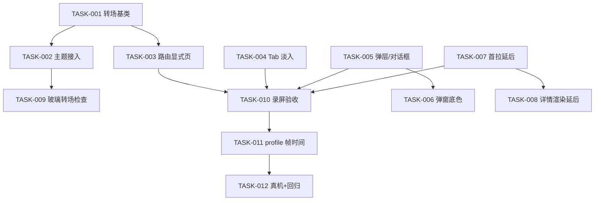

# 页面切换动画优化 · 实施计划

- 状态：待评审（Plan 阶段，未实施）
- 日期：2026-11-19
- 关联：[SPEC-UI-BEAUTIFY.md](SPEC-UI-BEAUTIFY.md)（Token/组件已完成）、[SPEC-LIQUID-GLASS.md](SPEC-LIQUID-GLASS.md)（玻璃导航层）

---

## 1. 现状与问题

| 现象 | 代码位置 | 说明 |
|---|---|---|
| 转场"风格不一致" | `main.dart` 的 `pageTransitionsTheme` | 只有「玻璃开启 + 高档设备」才用 `GlassPageTransitionsBuilder`；中/低档与关闭玻璃时用 Material 默认（Android 上是从下往上 + 缩放，观感偏"重"） |
| 部分跳转"生硬" | `router.dart` 各 `GoRoute` | 未指定 `pageBuilder`，全部走全局默认；`context.go` 与 `context.push` 混用，返回栈动画不一致 |
| Tab 切换无过渡 | `main.dart` `StatefulShellRoute` | 直接换 index，无交叉淡入，切换瞬间"跳"一下 |
| 弹层/对话框动画朴素 | `glass_overlays.dart` | `showAppSheet`/`showAppDialog` 用默认曲线，玻璃面板出现略突兀 |
| 首帧卡顿放大转场感 | 各页 `initState`/provider 首拉 | 转场期间同时做 DB 查询 + 网络，掉帧让动画显得"不流畅" |

**目标**：所有页面切换"轻、快、一致"，转场期间不掉帧；低端机不因动画变卡。

---

## 2. 设计决策（建议）

| 项 | 方案 | 时长/曲线 |
|---|---|---|
| 通用页面前进 | 新页 **淡入 + 12px 上移**（`FadeTransition` + `SlideTransition` 0.02） | 220ms `easeOutCubic` |
| 通用页面返回 | 淡出 + 8px 下移（与前进对称） | 180ms `easeOutCubic` |
| 玻璃档（高档） | 保留 `GlassPageTransitionsBuilder`（超椭圆圆角），但在其外层再套统一淡入，避免"硬切" | 260ms |
| 低档/关闭玻璃 | 仅 **淡入淡出**（无位移、无裁剪、无模糊） | 150ms `easeOut` |
| Tab 切换 | `AnimatedSwitcher` + 淡入 100ms（不动位移，避免整页重排） | 100ms |
| 底部弹层 | 上滑 24px + 淡入；关闭时反向 | 200ms `easeOutCubic` |
| 对话框 | 缩放 0.96→1.0 + 淡入 | 180ms `easeOutCubic` |
| 返回手势 | Android 保留系统预测返回；iOS 保留 Cupertino 侧滑 | — |

**性能红线**：转场只允许 `opacity/transform` 动画；**禁止**在转场中动画 backdrop 模糊/raster 重绘；转场期间新的图像解码要延后。

---

## 3. 任务清单

### Phase 1：统一转场基础设施（P0）
| 任务 | 内容 | 工时 | 依赖 |
|---|---|---|---|
| TASK-001 | 新建 `lib/src/app/design/page_transitions.dart`：`AppPageTransitions`（`builders` 按平台/档位返回，含 `FadeUpwardsPageTransition` 自定义实现：fade + 12px slide） | 2h | 无 |
| TASK-002 | `main.dart` 用 `AppPageTransitions.of(tier: glassTier, glassEnabled: …)` 替换现有 `pageTransitionsTheme` 三元逻辑；低档/关闭玻璃走纯 fade | 1h | TASK-001 |
| TASK-003 | `router.dart`：给主要二级页（详情、解析结果、练习、拆分确认、保存确认、组卷设置/预览、AI 配置、数据管理、成就）显式 `pageBuilder: AppPageTransitions.page(child)`，确保 push 与 go 行为一致 | 2h | TASK-001 |

### Phase 2：Tab 与弹层动画（P1）
| 任务 | 内容 | 工时 | 依赖 |
|---|---|---|---|
| TASK-004 | `ScaffoldWithNavBar` 的 `navigationShell` 外面包 `AnimatedSwitcher(100ms fade)`，仅在 Tab 切换时生效（不打断滚动位置） | 1.5h | 无 |
| TASK-005 | `glass_overlays.dart`：`showAppSheet` 自定义 `transitionAnimationController`（上滑 24px + fade 200ms）；`showAppDialog` 用 `showGeneralDialog` 实现 scale 0.96 + fade 180ms | 2h | 无 |
| TASK-006 | 玻璃弹窗底色不透明度 +55%（顺带修"游客提示弹窗太透明"问题） | 0.5h | TASK-005 |

### Phase 3：转场期掉帧治理（P0）
| 任务 | 内容 | 工时 | 依赖 |
|---|---|---|---|
| TASK-007 | 页面首拉数据延后到首帧之后：`addPostFrameCallback` + `Future.delayed(80ms)`（首页/错题本/复习/详情各一处） | 2h | 无 |
| TASK-008 | 详情页图片/题干大文本渲染延后到转场结束（`didChangeDependencies` + 一次 `pump` 后） | 1.5h | TASK-007 |
| TASK-009 | 玻璃转场的高档分支检查：确认 `GlassPageTransitionsBuilder` 不触发额外 backdrop 采样；如触发则改为纯 fade+scale | 1h | TASK-002 |

### Phase 4：验收（P0）
| 任务 | 内容 | 工时 | 依赖 |
|---|---|---|---|
| TASK-010 | 模拟器（Android 15）逐条转场录屏：详情前进/返回、解析结果、Tab 切换、弹层、对话框 | 1h | 全部 |
| TASK-011 | `flutter run --profile` 抓 raster/UI 线程时间：目标转场帧 raster ≤ 12ms（中档）、≤ 16ms（低档） | 1h | TASK-010 |
| TASK-012 | 真机（Redmi M511CD）验证 + 高/中/低档各跑一次；回归 `flutter test` | 1h | TASK-011 |

**总工时**：约 18.5h（含 20% 缓冲 ≈ 22h）

---

## 4. 依赖图

---

## 5. 里程碑

| 里程碑 | 完成标准 | 预估 |
|---|---|---|
| M1 转场统一 | 任意页面 push/pop 视觉一致，低档为纯 fade | Phase 1 完成 |
| M2 细节动画 | Tab 切换、弹层、对话框都有过渡且不"跳" | Phase 2 完成 |
| M3 流畅达标 | profile 抓帧：转场期间无长帧（>16ms 的帧 ≤5%） | Phase 3 完成 |
| M4 验收 | 模拟器+真机录屏通过，测试全绿 | Phase 4 完成 |

---

## 6. 风险与应对

| 风险 | 可能性 | 影响 | 应对 |
|---|---|---|---|
| 自定义转场与 `StatefulShellRoute` 冲突（Tab 内 push 的返回动画） | 中 | 返回方向错误/双动画 | 只在 `pageBuilder` 层加，不改 shell；TASK-003 单独验证每个分支 |
| `AnimatedSwitcher` 包 Tab 导致滚动位置丢失 | 高 | 体验倒退 | 用 `IndexedStack` + `AnimatedOpacity`（保持 state），不用重建 |
| 低端机 fade 也掉帧（整页重绘） | 中 | 反而更卡 | 低档改为"无动画直接切换"（可配置开关） |
| 玻璃转场 + 自定义 fade 叠加过重 | 中 | 深色下明显 | TASK-009 专门检查，必要时高档也只保留一种 |
| 动画与首拉数据竞争主线程 | 高 | 转场卡顿 | TASK-007/008 先做，再调动画参数 |

---

## 7. 验收标准

- [ ] 1. 5 类跳转（Tab 切换 / 进详情 / 返回 / 弹层 / 对话框）均有过渡，无"硬切"
- [ ] 2. 同一次跳转在 高/中/低 三档表现不同但**都无掉帧观感**（高档玻璃、中档 fade+轻微位移、低档纯 fade）
- [ ] 3. `flutter run --profile` 采集：转场期间长帧（>16ms）占比 ≤5%
- [ ] 4. `flutter test` 全绿；`flutter analyze` 0 error
- [ ] 5. 关闭玻璃（Material 回退）时动画依旧统一，不出现"关玻璃就没动画"
- [ ] 6. 系统返回手势/iOS 侧滑仍可用

---

## 8. 待你确认
1. **风格取向**：轻量「淡入+12px 上移」（推荐，iOS 感）还是保留 Android 默认「上滑+缩放」只是调快曲线？
2. **Tab 切换**是否要淡入（会有 100ms 内容闪动风险），还是保持"瞬间切换"只优化页面间跳转？
3. 是否同意 **低档设备默认关闭转场**（纯 fade 或直接切），以保帧率？
